<p align="center">
  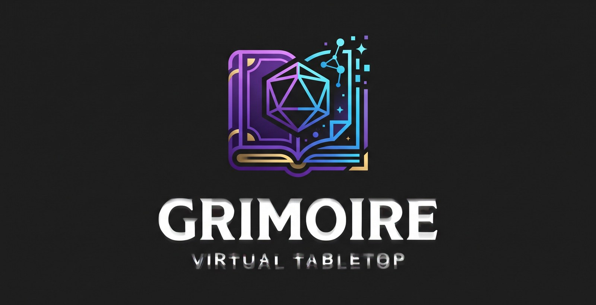
</p>

<h1 align="center">Grimório VTT</h1>

<p align="center">
  <strong>Wiki do mundo, fichas em PDF e tabuleiro com luz e névoa, tudo no mesmo lugar e no seu servidor.</strong>
</p>

<p align="center">
  
  
  
  
</p>

---

## Sumário

<table>
<tr>
<th width="34%" align="left">Conheça</th>
<th width="33%" align="left">Coloque no ar</th>
<th width="33%" align="left">Por dentro</th>
</tr>
<tr>
<td valign="top">

- [Por que o Grimório](#por-que-o-grimório)
- [Tabuleiro](#tabuleiro)
- [Luz, visão e névoa](#luz-visão-e-névoa)
- [Combate e efeitos](#combate-e-efeitos)
- [Dados e chat](#dados-e-chat)
- [Som](#som)
- [Wiki do mundo](#wiki-do-mundo)
- [Fichas em PDF](#fichas-em-pdf)

</td>
<td valign="top">

- [Início rápido](#início-rápido)
- [Como usar](#como-usar)
- [Sons padrão](#sons-padrão)
- [Configuração](#configuração)
- [Produção](#produção)
- [Backup](#backup)

</td>
<td valign="top">

- [Arquitetura](#arquitetura)
- [Testes](#testes)
- [Status do projeto](#status-do-projeto)
- [Limitações conhecidas](#limitações-conhecidas)
- [Como contribuir](#como-contribuir)
- [Licença](#licença)

</td>
</tr>
</table>

## Por que o Grimório

Hoje, uma sessão de RPG costuma pedir uma ferramenta para a lore, outra para a ficha customizada e uma terceira para o mapa. O Grimório junta as três num app só, que você hospeda e controla.

Ele foi feito para mestres e grupos pequenos (até cerca de 8 pessoas por mesa) que jogam sistemas próprios ou híbridos. Não traz regras de nenhum sistema embutidas: a ficha é o seu PDF, e a voz continua no Discord.

- **Do zero à mesa em minutos:** um assistente de 3 passos pede o nome da campanha, a ficha e o mapa, e termina com o link de convite.
- **Sem módulos nem plugins:** tudo vem embutido e funciona sem configurar.
- **Seus dados são seus:** o app não tem analytics, e os arquivos ficam no seu servidor.

<p align="center">
  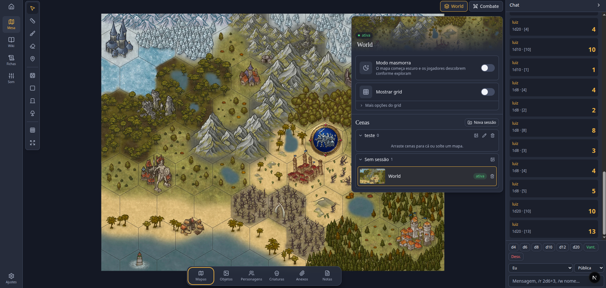
  <br>
  <sub>A mesa: mapa, ferramentas, cenas, biblioteca e chat na mesma tela.</sub>
</p>

## Recursos

### Tabuleiro

Monte a cena arrastando o que precisa da biblioteca, e deixe aberto por cima do mapa só o que estiver usando.

- Cenas agrupadas em sessões, grid opcional, tokens com barras e condições, camada do mestre
- Régua, ping e desenho livre
- Biblioteca com pastas: arraste mapas, objetos, personagens e criaturas para a cena
- Janelas flutuantes para fichas, notas, anexos e combate, que minimizam, maximizam e dividem a tela

<table>
<tr>
<td width="59%" align="center" valign="top">
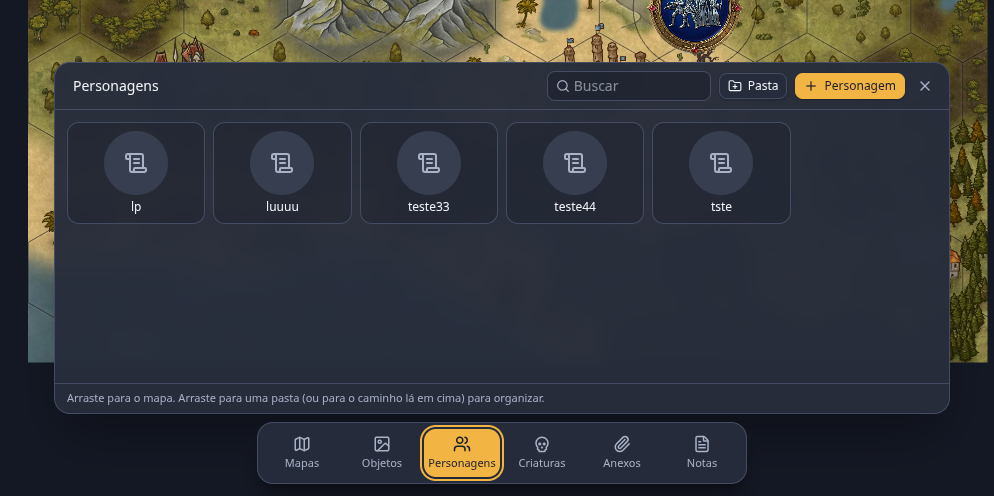
<br>
<sub>Biblioteca: mapas, objetos, personagens, criaturas, anexos e notas.</sub>
</td>
<td width="41%" align="center" valign="top">
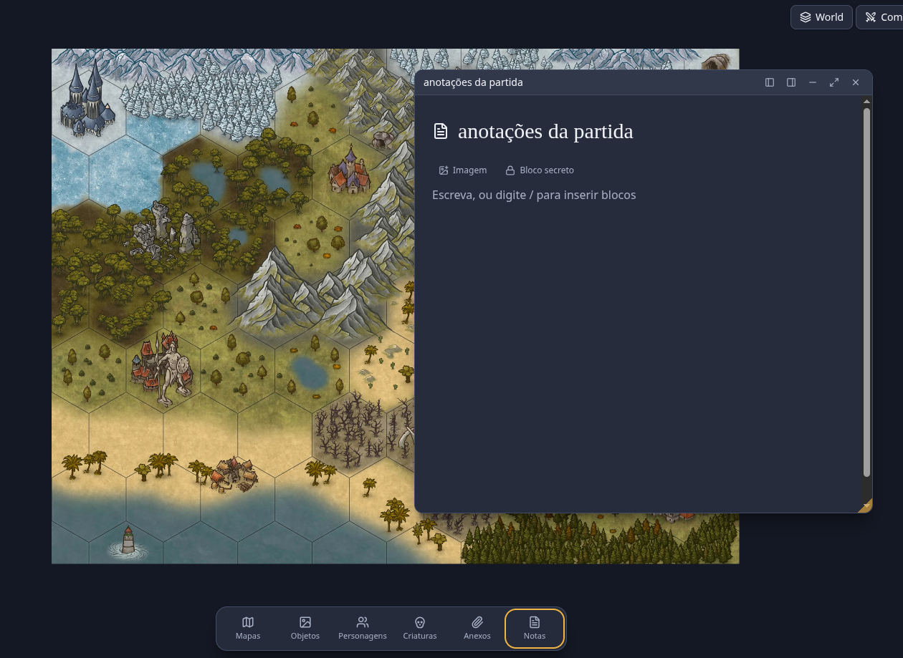
<br>
<sub>Notas em janela, sem sair do mapa.</sub>
</td>
</tr>
</table>

### Luz, visão e névoa

No **modo masmorra**, o mapa começa escuro e os jogadores descobrem o terreno conforme exploram. O mestre continua vendo tudo.

- Paredes, portas e janelas, com iluminação dinâmica, visão e névoa de guerra
- Raio de luz ajustável em cada token
- Botão para refazer a névoa e recomeçar a exploração

<p align="center">
  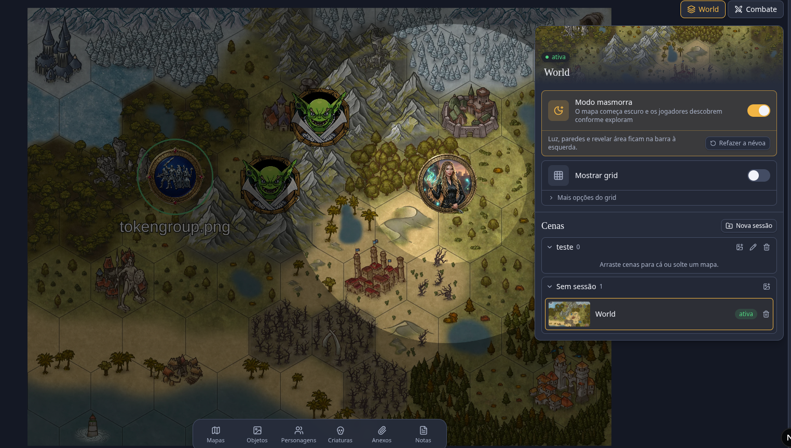
  <br>
  <sub>O mestre vê o mapa inteiro, com a luz de cada token marcada.</sub>
</p>

<table>
<tr>
<td width="55%" align="center" valign="top">
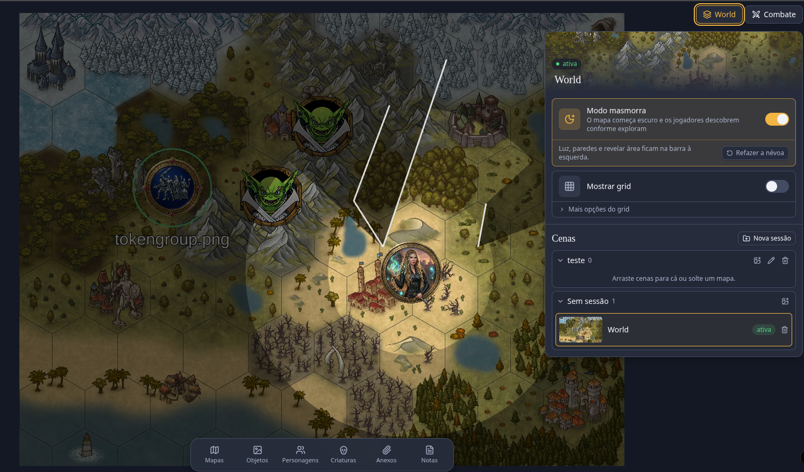
<br>
<sub>Paredes cortam a luz em tempo real.</sub>
</td>
<td width="45%" align="center" valign="top">
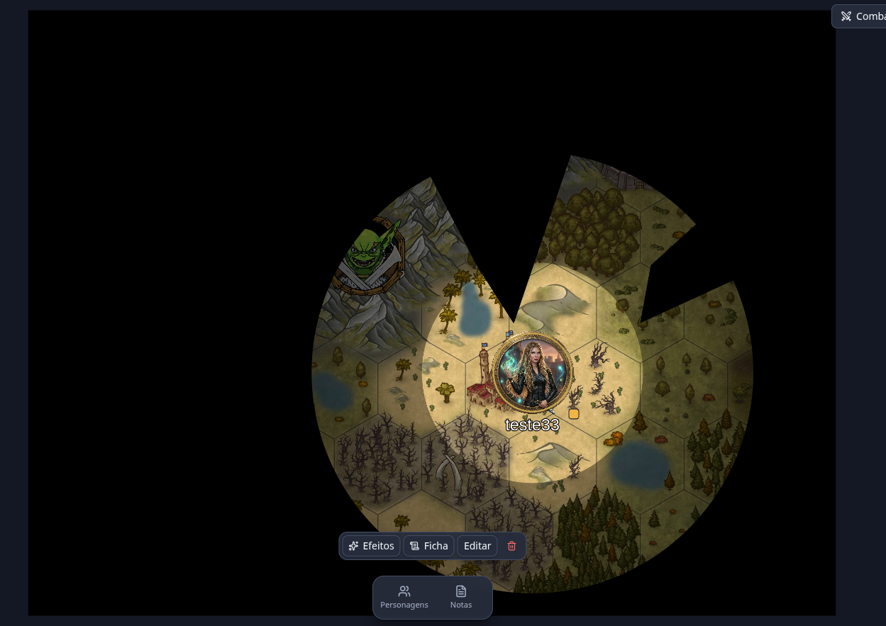
<br>
<sub>O jogador vê só o que o personagem enxerga.</sub>
</td>
</tr>
</table>

### Combate e efeitos

<table>
<tr>
<td width="34%" valign="top">

**Do primeiro turno ao último golpe, sem sair do mapa.**

- Iniciativa, rodadas, PV e CA de cada combatente
- Dano e cura direto na lista
- NPC rápido e nova rolagem de iniciativa
- 24 efeitos prontos, além dos seus, com duração em rodadas

</td>
<td width="30%" align="center" valign="top">
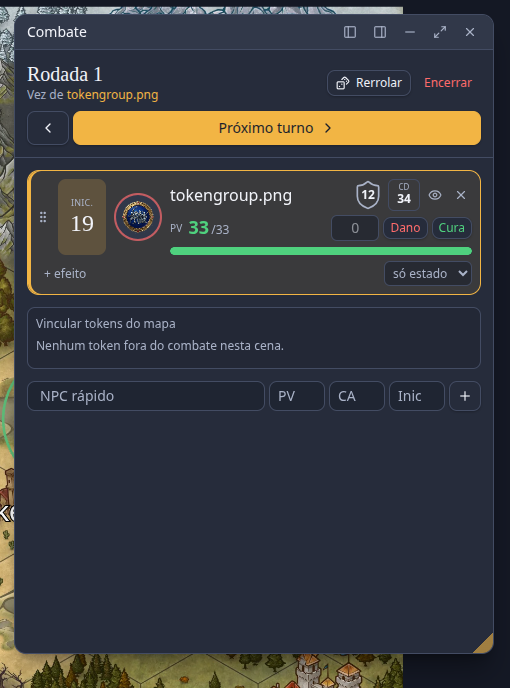
<br>
<sub>Rastreador de combate.</sub>
</td>
<td width="36%" align="center" valign="top">
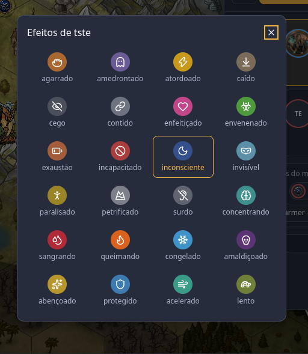
<br>
<sub>Efeitos no token, com um clique.</sub>
</td>
</tr>
</table>

### Dados e chat

<table>
<tr>
<td width="58%" align="center" valign="top">
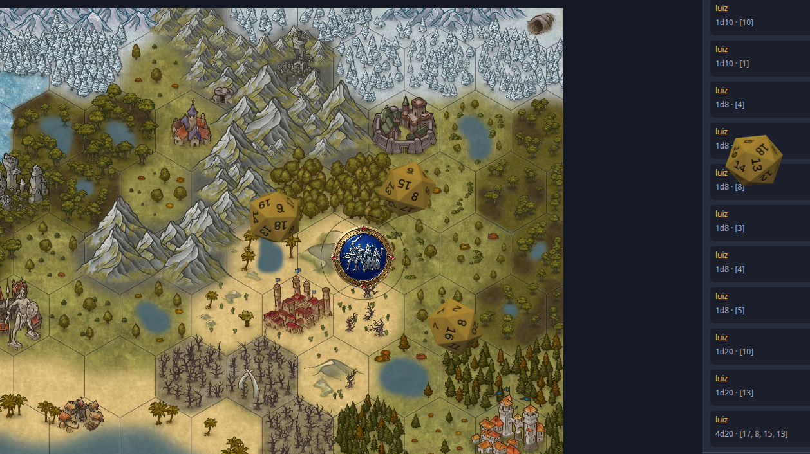
<br>
<sub>Todos veem o dado cair, e o resultado vai para o chat.</sub>
</td>
<td width="42%" valign="top">

- Notação completa: `2d6+3`, `1d20+@mod_forca`, `4d6kh3`, `2d20kl1`, `1d6!`
- Dado 3D animado para todos, com o resultado sorteado pelo servidor
- Atalhos de vantagem e desvantagem
- Rolagens públicas, ocultas ou privadas
- Chat por personagem, com `/r` para rolar e `/w` para sussurrar

</td>
</tr>
</table>

### Som

<table>
<tr>
<td width="33%" align="center" valign="top">
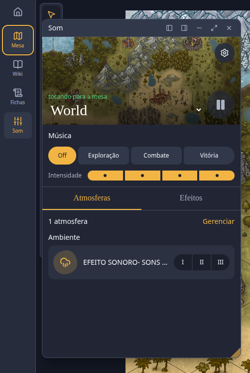
<br>
<sub>Música e atmosferas.</sub>
</td>
<td width="33%" align="center" valign="top">
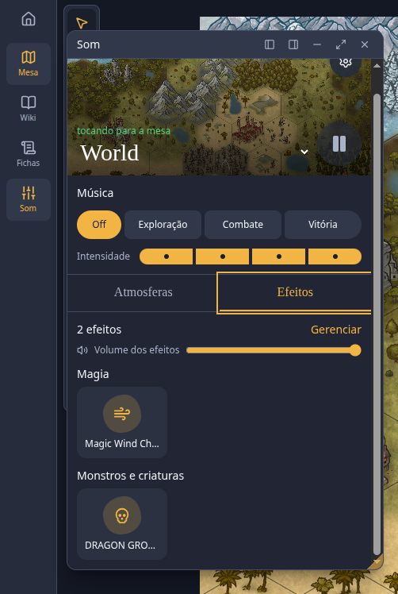
<br>
<sub>Efeitos por categoria.</sub>
</td>
<td width="34%" valign="top">

**O clima da cena toca para a mesa inteira.**

- Música de exploração, combate e vitória, com quatro níveis de intensidade
- Atmosferas em camadas, cada uma com três volumes
- Efeitos com um clique
- Tudo sincronizado entre os jogadores

</td>
</tr>
</table>

### Wiki do mundo

Lugares, personagens, facções e sessões ficam ligados entre si, e o segredo do mestre não vaza para os jogadores.

- Árvore de páginas, editor rico com comando `/` e templates de página
- Edição colaborativa ao vivo, com cursor e nome de quem está escrevendo
- Links `[[ ]]` entre páginas, backlinks e busca com `Ctrl+K`
- Blocos secretos e páginas ocultas, com a mesma permissão aplicada na busca e nos quadros
- Mapas com pins, linha do tempo e quadro infinito (Excalidraw)
- Exportação da campanha em Markdown + imagens

<table>
<tr>
<td width="50%" align="center" valign="top">
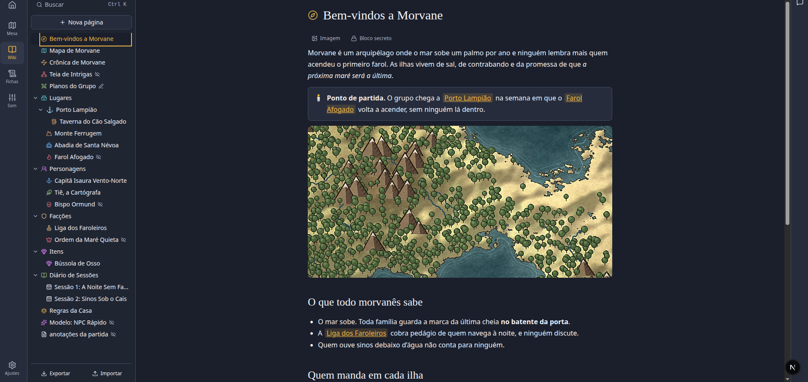
<br>
<sub>Páginas ricas, com links entre si.</sub>
</td>
<td width="50%" align="center" valign="top">
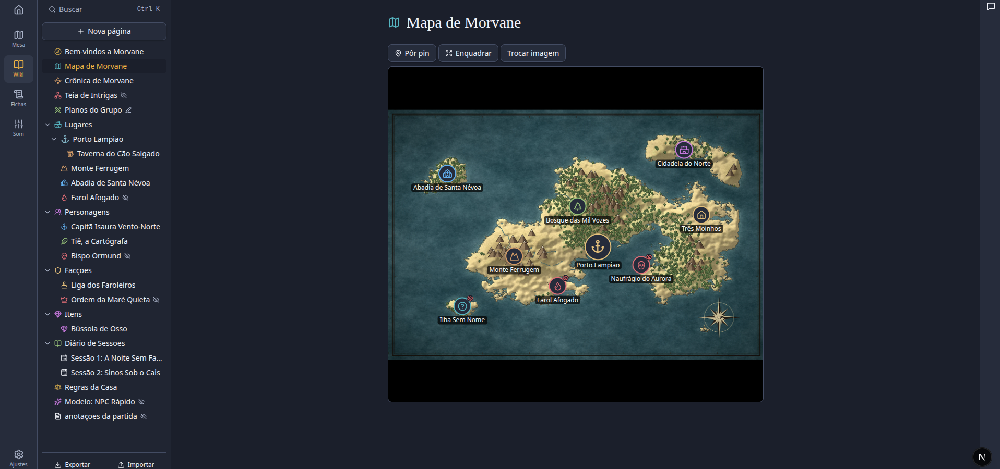
<br>
<sub>Mapas com pins, inclusive ocultos.</sub>
</td>
</tr>
<tr>
<td width="50%" align="center" valign="top">
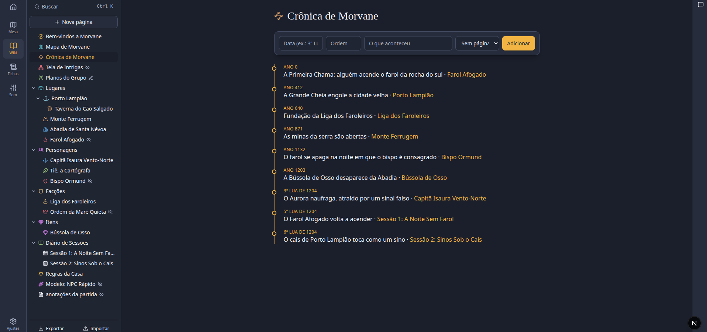
<br>
<sub>Linha do tempo ligada às páginas.</sub>
</td>
<td width="50%" align="center" valign="top">
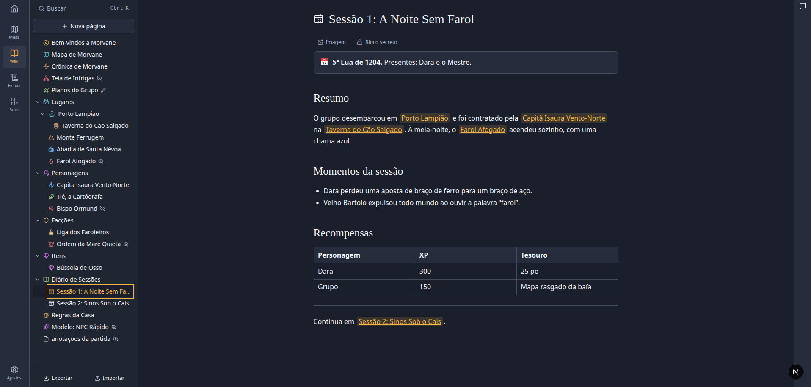
<br>
<sub>Diário de sessões, com tabelas e links.</sub>
</td>
</tr>
</table>

<table>
<tr>
<td width="54%" valign="top">

**Comece com um modelo.**

A wiki já traz modelos de personagem, local, facção, item e evento. Qualquer página sua também pode virar modelo, como o *NPC Rápido* ao lado, e passa a aparecer no mesmo menu.

</td>
<td width="25%" align="center" valign="top">
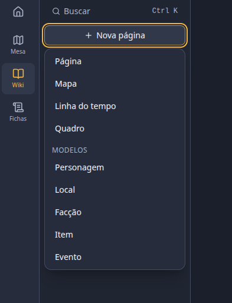
<br>
<sub>Modelos prontos.</sub>
</td>
<td width="21%" align="center" valign="top">
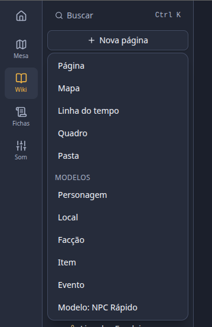
<br>
<sub>Com um modelo seu.</sub>
</td>
</tr>
</table>

### Fichas em PDF

O Grimório não impõe sistema: a ficha é o seu PDF, com campos desenhados exatamente onde você quiser.

- Importe **qualquer PDF** e desenhe os campos sobre ele; PDFs com formulário viram ficha em um clique
- Campos de texto, número, checkbox, contador e imagem, com fórmulas (`floor((forca - 10) / 2)`)
- Botões de rolagem ligados aos campos da ficha
- Preenchimento em tempo real entre mestre e jogadores
- Moldes reutilizáveis, mais de uma ficha por personagem e controle de quem joga com cada um
- Exportação do PDF preenchido

<p align="center">
  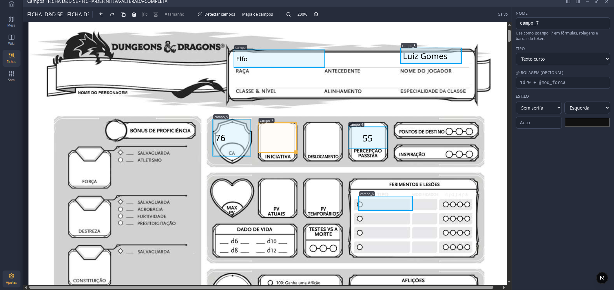
  <br>
  <sub>O editor de campos: desenhe sobre o PDF e ligue cada campo a fórmulas e rolagens.</sub>
</p>

<table>
<tr>
<td width="48%" align="center" valign="top">
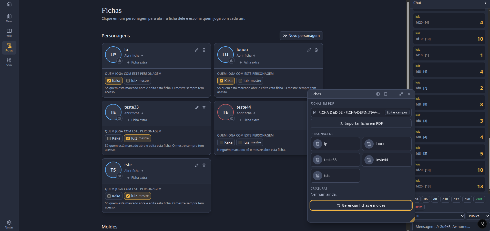
<br>
<sub>Personagens e quem joga com cada um.</sub>
</td>
<td width="52%" align="center" valign="top">
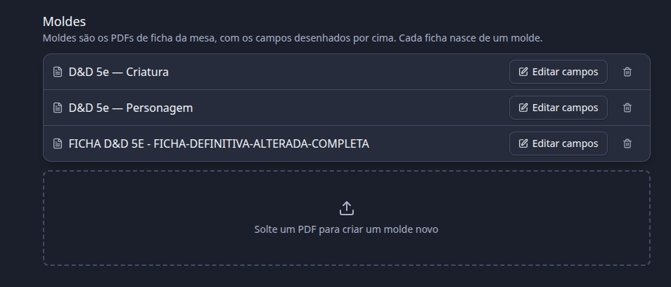
<br>
<sub>Moldes: cada ficha nasce de um PDF.</sub>
</td>
</tr>
</table>

<p align="right"><a href="#sumário">↑ Voltar ao sumário</a></p>

## Início rápido

Você vai precisar de **Node.js 22**, **pnpm** (`corepack enable` já resolve), **Docker** e **ffmpeg** (usado no envio de músicas).

```sh
git clone <url-do-repositório> grimorio
cd grimorio
cp .env.example .env                   # troque as senhas e o BETTER_AUTH_SECRET
docker compose up -d postgres minio    # banco e arquivos
pnpm install
pnpm db:push                           # cria as tabelas
pnpm dev                               # web em :3000, realtime em :4000
```

Abra <http://localhost:3000>, crie uma conta e siga o assistente.

> [!NOTE]
> A senha de `POSTGRES_PASSWORD` precisa ser igual à que aparece em `DATABASE_URL`. Se a porta 5432 estiver ocupada, ajuste `PG_PORT` e a porta na `DATABASE_URL`.

<p align="center">
  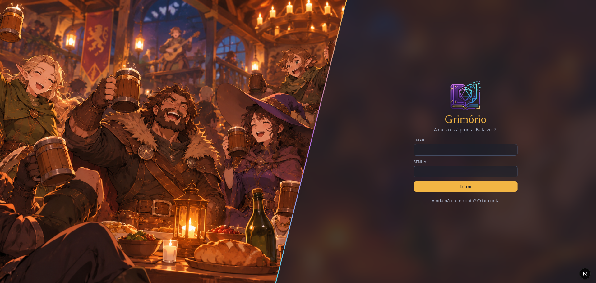
  <br>
  <sub>A mesa está pronta. Falta você.</sub>
</p>

## Como usar

**A ficha é o seu PDF.** Importe em **Fichas → Importar ficha em PDF** e desenhe as caixas de texto sobre ele. Depois, na própria ficha, o mestre usa **Editar campos** para desenhar uma caixa e já digitar nela.

**Na mesa:**

- **Biblioteca** (barra embaixo do mapa): Mapas, Objetos, Personagens, Criaturas, Anexos e Notas, cada um com pastas. Envie arquivos, crie personagens e criaturas e **arraste para o mapa**. Arraste para uma pasta para organizar.
- **Janelas:** fichas, notas, anexos e combate abrem por cima do mapa, quantas você quiser, e ficam abertas até serem fechadas. O jogador já entra na mesa com a própria ficha aberta.
- **Tokens:** clique para abrir a ficha, entrar no combate ou trocar a imagem. Em Editar, você vincula a ficha e ajusta o raio da luz. A alça amarela muda o tamanho.
- **Seleção e câmera:** arraste no vazio para marcar uma área. Botão direito ou Espaço + arrastar movem o mapa.
- **Cenas:** ficam agrupadas em sessões sanfonadas, que são as pastas de Mapas da biblioteca.

### Sons padrão

Áudios em `padroes/` no bucket do MinIO valem para todas as campanhas. Solte os arquivos pelo console (<http://localhost:9011>) na pasta certa:

| Pasta | Subpastas |
| --- | --- |
| `musica/` | `exploracao`, `combate`, `vitoria` |
| `atmosferas/` | `ambiente`, `acao` |
| `efeitos/` | `impacto`, `pessoas`, `magia`, `armas`, `objetos`, `monstros-e-criaturas` |

As pastas nascem na primeira vez que o mestre abre a mesa de som. Ao abri-la, no máximo uma vez por minuto, o app converte o que for novo (em `padroes/convertidos/`, que não deve ser alterada) e remove o que saiu das pastas. Efeitos precisam ter até 60 s, e arquivos recusados aparecem no log do `web`.

## Configuração

Tudo fica no `.env`; o [.env.example](.env.example) traz os valores iniciais.

| Variável | Para que serve |
| --- | --- |
| `POSTGRES_PASSWORD`, `DATABASE_URL`, `PG_PORT` | Banco de dados |
| `BETTER_AUTH_SECRET` | Chave da sessão; gere com `openssl rand -base64 32` |
| `BETTER_AUTH_URL` | Endereço que o navegador usa para acessar o app |
| `NEXT_PUBLIC_RT_URL` | Realtime visto pelo navegador; em produção atrás do Caddy, fica vazio |
| `DOMAIN` | Domínio público em produção |
| `DISCORD_CLIENT_ID`, `DISCORD_CLIENT_SECRET` | Opcional: o login com Discord aparece sozinho quando preenchidos |
| `S3_ENDPOINT`, `S3_BUCKET`, `S3_ACCESS_KEY`, `S3_SECRET_KEY` | Armazenamento no MinIO ou em outro S3 compatível |
| `UPLOAD_DIR` | Pasta local usada quando `S3_ENDPOINT` não está definido |

## Produção

O alvo é uma única VPS. O Docker Compose sobe web, realtime, Postgres, MinIO e Caddy:

```sh
cp .env.example .env    # DOMAIN=seu.dominio; POSTGRES_PASSWORD, S3_SECRET_KEY e BETTER_AUTH_SECRET fortes
docker compose --profile full up -d --build
```

O Caddy serve tudo em `https://$DOMAIN` (web, `/rt` e `/collab` no mesmo domínio, para o cookie de sessão valer nos dois). O realtime aplica as migrações de `packages/db/migrations` antes de subir.

A imagem é multi-arch, para amd64 e arm64:

```sh
docker buildx build --platform linux/amd64,linux/arm64 .
```

### Backup

```sh
pnpm backup    # backups/grimorio-AAAAMMDD-HHMMSS.tar.gz: banco.dump + arquivos
```

Para restaurar, rode `pg_restore -U grimorio -d grimorio --clean banco.dump` dentro do container do Postgres e copie `minio/` de volta para o volume `miniodata` (ou `uploads/` para `UPLOAD_DIR`).

A wiki também exporta e importa em Markdown + imagens pela barra lateral.

## Arquitetura

Um monorepo Turborepo com dois processos e um núcleo de domínio compartilhado. As regras de permissão ficam em um único `can()`, usado por páginas, sockets e documentos colaborativos.

```text
apps/
  web/        Next.js: rotas, Server Actions, uploads
  realtime/   Node: Socket.IO em /rt e Hocuspocus em /collab
packages/
  core/       Permissões, dados, fórmulas, ficha, tabuleiro, visão
  db/         Schema Drizzle, migrações e autenticação
e2e/          Testes Playwright
```

| Camada | Tecnologias |
| --- | --- |
| Interface | Next.js 16, React 19, Tailwind CSS 4, next-intl |
| Tabuleiro | PixiJS |
| Wiki | TipTap, Yjs, Hocuspocus, Excalidraw |
| Fichas | pdf.js, pdf-lib |
| Tempo real | Socket.IO |
| Dados | PostgreSQL 17, Drizzle ORM, MinIO/S3 |
| Autenticação | Better Auth (e-mail/senha com argon2 e Discord) |
| Infraestrutura | Docker Compose, Caddy, GitHub Actions |

A especificação completa, com requisitos e decisões de arquitetura, está no [SDD.md](SDD.md).

## Testes

```sh
pnpm typecheck    # TypeScript + chaves de tradução (pt/en)
pnpm test         # núcleo: permissões, dados, fórmulas, ficha, tabuleiro, visão (node:test)
pnpm e2e          # Playwright; sobe uma instância própria em :3010/:4010
```

## Status do projeto

A v1 está completa, com as ressalvas listadas em [Limitações conhecidas](#limitações-conhecidas).

| Fase | Entrega | Status |
| --- | --- | --- |
| 0 | Monorepo, `can()`, parser de dados, fórmulas, schema, compose | ✅ |
| 1 | Contas (Better Auth + Discord), campanha, convite, papéis, assistente de 3 passos | ✅ |
| 2 | Chat e dados pelo Socket.IO, visibilidade de rolagem | ✅ |
| 3 | Fichas: editor sobre PDF, fórmulas, preenchimento ao vivo, exportação | ✅ |
| 4 | Tabuleiro: cenas, grid, tokens, pins, combate | ✅ |
| 5 | Paredes, luz, visão e névoa | ✅ |
| 6 | Wiki colaborativa com Yjs/Hocuspocus e quadro | ✅ |
| 7 | Dado 3D, backup, i18n, polimento | ✅ |

### Limitações conhecidas

- A tradução para inglês cobre as telas principais (login, campanhas, assistente, ajustes, chat, fichas, mesa, cenas, combate, wiki). O editor de molde, o editor de pin/token, as ferramentas de luz, o mapa, a linha do tempo, o quadro e as mensagens de erro do servidor ainda estão só em português.
- Sem `S3_ENDPOINT`, os arquivos vão para o disco local. Arquivos antigos no disco continuam sendo lidos depois da migração para o MinIO.
- Os pins usam ícones do Lucide, sem a biblioteca game-icons.net.
- Fórmulas entre fichas (`@companheiro.forca`) resolvem um nível.
- O quadro sincroniza pelo Socket.IO, e não pelo Yjs, para o servidor poder esconder cartões de páginas ocultas.
- O grid hexagonal ficou fora da v1.

## Como contribuir

Contribuições são bem-vindas, de correções a novos recursos. Para mudanças grandes, abra uma issue antes para alinhar a ideia.

1. Crie uma branch `feature/sua-mudanca`.
2. Faça a mudança seguindo o estilo do código ao redor.
3. Novos textos de interface entram em `apps/web/messages/pt.json` e `en.json`.
4. Regras de domínio vão em `packages/core`, com testes.
5. Rode `pnpm typecheck` e `pnpm test` antes de abrir o pull request; o CI também roda os testes E2E.

Toda feature deve respeitar as regras de produto do [SDD](SDD.md#simplicidade-é-o-diferencial): funcionar sem configuração, mostrar poucos controles, editar no lugar e falar a linguagem da mesa.

## Licença

A licença ainda não foi publicada. A proposta registrada no [SDD](SDD.md) é a AGPL-3.0, para que forks hospedados continuem abertos. Enquanto o arquivo `LICENSE` não entrar no repositório, nenhum direito de uso é concedido.

<br>

<p align="center">
  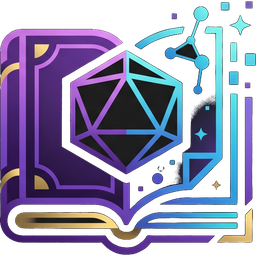<br>
  <sub>Feito para mesas de RPG, por quem joga nelas.</sub>
</p>
